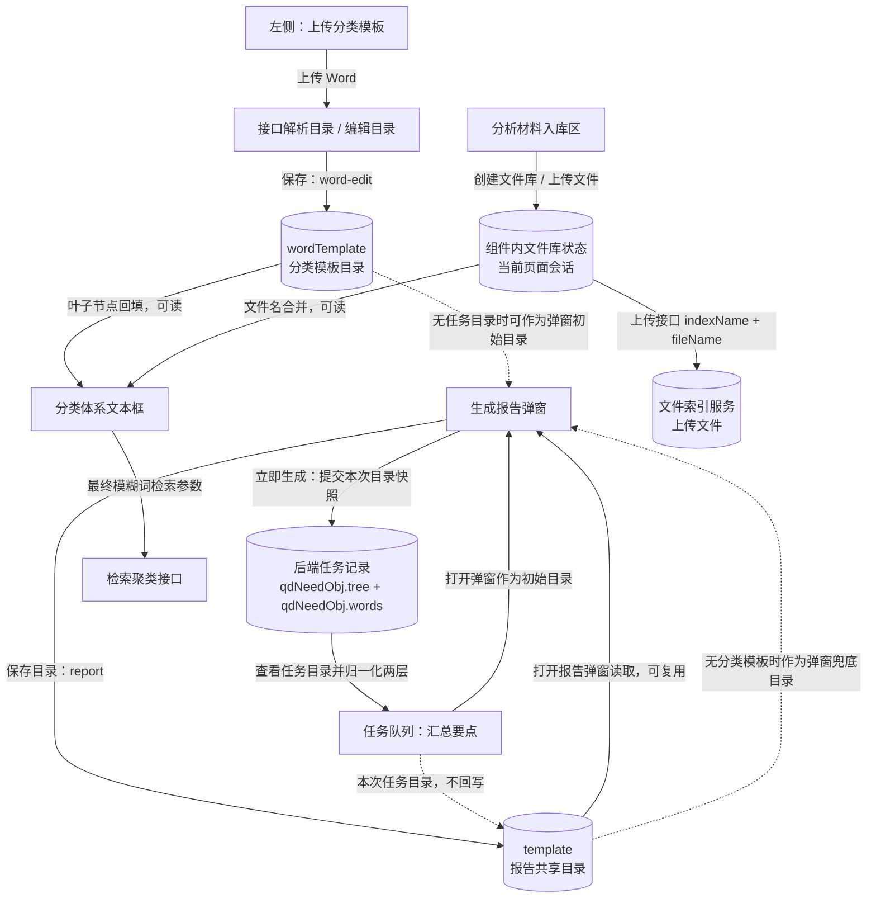
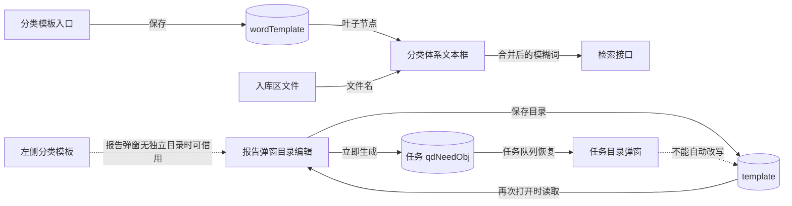
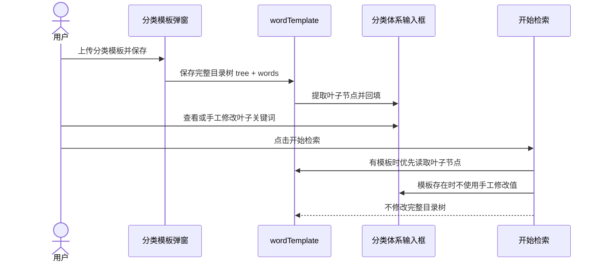
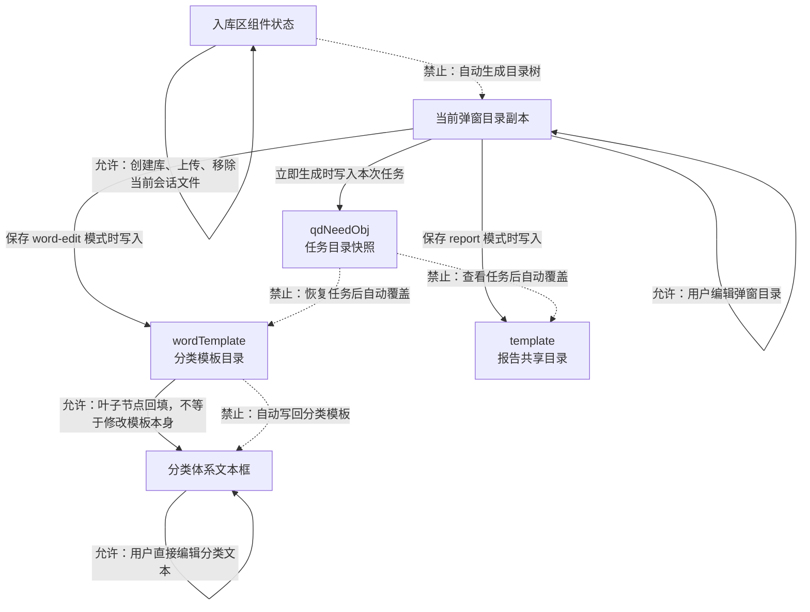

# 目录模板与分类体系逻辑说明

本文档梳理建议检索页面中目录模板、分类体系、分析材料入库区、报告生成弹窗及任务队列之间的共享关系。

## 关系图总览



## 五条数据链路



## 上传分类模板后，开始检索是否会替换目录结构

结论：

- **不会替换目录结构。**
- 开始检索只读取分类模板的叶子节点作为模糊词进行检索。
- 检索条件不会反向修改 `wordTemplate.tree`。
- 分类体系输入框只是检索关键词来源之一，不是目录结构编辑器。



### 实际判断优先级

```text
开始检索取模糊词时：

wordTemplate 有数据且有叶子节点
    -> 直接使用模板叶子节点
    -> 不使用分类体系文本框的手工修改内容

否则
    -> 使用分类体系文本框内容

之后无论模板是否存在
    -> 追加分析材料入库区的文件名
```

对应关系：

```js
const fuzzy =
  templateHasData && templateLeafWords.length
    ? templateLeafWords.join('\n')
    : filterSemiFuzzyWord || ''
```

因此：

- 模板保存后，分类体系会在页面上显示模板叶子节点。
- 用户修改分类体系文本框，但只要模板仍然有效，开始检索不会采用修改后的文本。
- 入库区文件名仍会追加到检索模糊词中。
- 开始检索不会把分类体系文本变回目录结构，也不会更新模板节点。

### 哪些操作会影响目录，哪些不会

| 操作 | 是否修改目录结构 |
|---|---|
| 上传分类模板并保存 | 是；更新 `wordTemplate.tree` |
| 在分类模板弹窗中编辑节点 | 是；保存后更新 `wordTemplate.tree` |
| 开始检索 | 否；只读取叶子节点用于检索 |
| 在分类体系文本框修改叶子词 | 否；不会写回目录树 |
| 上传分析材料入库区文件 | 否；只追加检索模糊词 |
| 切换来源库 | 否；会清空分类体系及 `wordTemplate` |
| 重置筛选条件 | 否；会清空分类体系及独立模板 |

### 目录与检索关键词的映射

```text
分类模板目录
    A
    ├── A1
    ├── A2
    └── A3

保存后回填分类体系：

A1
A2
A3

开始检索参数：

模糊词 = A1 + A2 + A3 + 入库区文件名

目录结构保持：

A
├── A1
├── A2
└── A3
```

## 谁可以更改谁



## 1. 涉及的入口

### 1.1 左侧“上传分类模板”

入口：`AdviceClusterLeft.vue` 的 `openWordTemplateModal()`

- 打开统一目录模板弹窗。
- 弹窗模式为 `word-edit`。
- 保存后使用独立的 `wordTemplate` Vuex 模块。
- 目录的叶子节点会回填到“构建分析的分类体系”的模糊词输入框。
- 该模板只用于分类检索，不是汇总要点和分析报告保存目录的主模板。

主要数据：

- `tree`：目录树。
- `words`：节点名称集合，主要用于检索词。
- `wordFileName`：上传的 Word 文件名。

### 1.2 生成报告弹窗中的目录模板

入口：右侧“生成报告”或“汇总要点”按钮，统一打开 `GenerateReportModal.vue`。

- 弹窗模式为 `report`。
- 目录树、生成方式、Word 文件上传和目录编辑共用同一个弹窗组件。
- 保存目录后使用共享 `template` Vuex 模块。
- 汇总要点和分析报告共用该目录模板。
- 该模板不会覆盖左侧“上传分类模板”保存的 `wordTemplate`。

主要数据：

- `tree`：目录树。
- `words`：目录中所有节点名称。
- `wordFileName`：报告弹窗上传 Word 时的文件名。

### 1.3 分析材料入库区

入口：`AdviceClusterLeft.vue` 的“分析材料入库区”。

- 先创建文件库，再向文件库上传文件。
- 文件库数据保留在组件当前状态中：

```js
{
  id: 'lib_xxx',
  name: '文件库名称',
  indexName: '文件库拼音索引名',
  files: ['文件名']
}
```

- 文件上传接口参数使用：

```js
{
  fileName,
  indexName: library.indexName,
  force: false
}
```

- 入库区不是目录模板，不会保存目录结构。
- 入库区使用的是组件当前会话状态；文件库名称转为无声调拼音后作为接口索引名。

### 1.4 任务队列中的汇总要点

入口：任务队列记录，点击“汇总要点”任务查看详情。

- 任务中的目录来自任务提交时保存的 `qdNeedObj.tree`。
- 如果没有完整目录树，则使用任务提交时保存的 `qdNeedObj.words`。
- 该目录来自当次任务载荷，不是共享 `template` 模块中保存的目录。
- 单独保存目录与任务队列目录是两套数据来源。

## 2. 两套独立模板存储

| 存储对象 | 所属 Store | 使用入口 | 主要用途 |
|---|---|---|---|
| `wordTemplate` | `store/modules/wordTemplate.js` | 左侧“上传分类模板”/`word-edit` 弹窗 | 分类体系、模糊词回显、检索叶子词 |
| `template` | `store/modules/template.js` | 生成报告弹窗/`report` 弹窗 | 汇总要点、分析报告共用目录 |

两者相互隔离：

- 保存 `wordTemplate` 不会覆盖 `template`。
- 保存 `template` 不会覆盖 `wordTemplate`。
- 汇总要点或分析报告打开弹窗时，会优先复用 `wordTemplate` 的目录；若无目录，再复用 `template`。
- 该优先复用只是页面打开时的初始目录选择，不会把两套模板合并成同一份数据。

## 3. 左侧分类体系与模板、入库区的合并逻辑

左侧分类体系最终参与检索的模糊词由三部分组成：

1. 分类模板叶子节点。
2. 分类体系文本框中的内容。
3. 分析材料入库区中文件的展示名称。

计算顺序：

```text
分类模板叶子节点
        +
分类体系文本框内容
        +
入库区已选文件库中文件名
```

对应逻辑位于 `AdviceClusterLeft.vue`：

- `templateLeafWords`：读取 `templateTree` 中所有叶子节点名称。
- `filterSemiFuzzyWord`：分类体系输入框。
- `warehouseFiles`：入库区中当前选中文件库的文件名。
- `mergedFuzzyWords`：最终合并结果。
- `warehouseLabels`：检索历史中展示入库区名称，不是提交给检索接口的文件目录。

合并时去除重复文件/词，并按换行拼接，因此入库区材料会作为分类检索的模糊词来源参与检索。

模板叶子节点回填规则：

```text
wordTemplate 有数据且存在叶子节点
  -> 将叶子节点按换行回填分类体系
否则
  -> 保留分类体系已有文本框内容
```

## 4. 目录模板弹窗的读取优先级

### 4.1 左侧“上传分类模板”

打开 `word-edit` 模式时：

```text
传入的 initialTree / initialFileName
    优先于
wordTemplate 中已保存的数据
```

没有传入时，读取 `wordTemplate.tree` 和 `wordTemplate.wordFileName`。

保存时：

```text
saveTemplateModal()
  -> 路由到 wordTemplate/saveTemplate
  -> 保存 tree、words、wordFileName
  -> 关闭弹窗
```

### 4.2 汇总要点、分析报告弹窗

打开 `report` 模式且不是任务队列续报时：

```text
1. 读取 wordTemplate.tree
2. 没有 wordTemplate，则读取 template.tree
3. 两者都没有，则由左侧关键词生成单层目录
```

具体优先顺序：

```text
任务队列目录（仅任务队列入口且有目录）
  > wordTemplate.tree
  > template.tree
  > leftKeywords 转换出的单层目录
```

该逻辑位于 `AdviceClusterRight.vue` 的 `openGenerateReportModal()`。

### 4.3 任务队列目录读取

任务队列汇总要点详情进入报告弹窗时：

```text
payload.type === '1'
  且 payload.tree 为数组
  -> 使用 payload.tree
  -> normalizeToTwoLevels，归一为最多两层
```

归一化后：

- 根节点保留名称。
- 一级子节点保留名称。
- 再深层的子节点不会继续保留。
- 目录节点 ID 会重新生成为 `1`、`1-1` 等形式。

如果任务载荷只有 `qdNeedObj.words`、没有 `qdNeedObj.tree`：

- 不直接把 `words` 当作当前任务目录树。
- 弹窗会按普通生成报告入口继续读取共享模板或关键词兜底目录。

## 5. 目录保存与任务提交的数据区别

### 5.1 单独保存的目录

用户在统一弹窗中点击保存目录时：

```js
{
  tree,
  words: TreeHelper.collectNodeNames(tree),
  wordFileName,
  delegation,
  cbdw
}
```

按弹窗模式写入：

- `word-edit` → `wordTemplate`。
- `report` → `template`。

该保存操作只更新当前页面的 Vuex 状态，不保存到任务载荷。

### 5.2 点击立即生成时保存目录

普通汇总要点或分析报告点击“立即生成”后：

- 当前弹窗目录 `tree` 会写入共享 `template`。
- 同时目录节点会随任务一起提交到后端。
- 汇总任务提交：

```js
qdNeedObj = {
  words: 当前目录叶子节点名称,
  tree: 当前目录,
  module
}
```

- 分析报告任务提交：

```js
qdNeedObj = {
  words: 当前目录全部节点名称,
  tree: 当前目录
}
```

- 如果没有目录，则提交节点名称数组；`tree` 字段为空或不提交。

因此，“立即生成时保存共享目录”和“任务提交时携带目录载荷”是两个动作：

- 共享目录：用于下次打开报告弹窗时作为初始模板。
- 任务载荷：用于保存本次任务所使用的目录，任务队列可以据此恢复目录。

## 6. 两种目录的关键区别

| 项目 | 单独保存目录（共享模板） | 任务队列目录（任务载荷） |
|---|---|---|
| 数据位置 | `template` 或 `wordTemplate` Vuex 状态 | 后端任务记录中的 `qdNeedObj` |
| 生命周期 | 页面内共享，主要用于再次打开弹窗 | 随任务记录保存，用于任务详情恢复 |
| 是否随任务提交 | 点击立即生成时会写入本次任务 | 本身就是任务提交载荷的一部分 |
| 使用入口 | 生成报告弹窗、分类模板弹窗 | 任务队列点击汇总要点/查看详情 |
| 层级处理 | 保留弹窗目录编辑后的原树 | 汇总任务恢复时只保留根节点和一级子节点 |
| 修改隔离性 | 修改会影响后续使用该模板 | 修改任务恢复目录时只影响弹窗中的当次编辑副本 |

任务队列目录优先级应理解为“本次任务记录优先”，不是“覆盖并改写共享模板”。点击任务队列汇总要点继续生成时，如果弹窗关闭或保存目录，只应保存到当前任务流程，不应直接修改此前保存的共享目录，除非业务明确要求同步保存。

## 7. `GenerateReportModal.vue` 中的生成方式

弹窗中的目录结构与生成方式相互独立。

### 7.1 汇总要点类型

- `summary-current`：按当前分类体系汇总。
- `summary-plan`：按照十五五规划纲要归类。
- 对应接口 `module = "shiwuwu"`。
- `summary-representative`：代表审议意见模板。
- 对应接口 `module = "representative"`。

汇总提交时：

- 所有叶子节点名称作为 `word`。
- 完整目录作为任务载荷中的 `tree`。
- `module` 作为汇总模式。

### 7.2 分析报告类型

- `report-default`：默认分析报告。
- `report-digest`：摘报。
- `report-delegation`：按代表团生成。
- `report-undertaker`：按承办单位生成。

目录中的节点名称用于报告预设小主题。

提交任务时携带：

```js
{
  aiObj: {
    obj: 选中数据,
    preset_subtopics: 目录转换后的预设小主题,
    type: 报告类型,
    delegation / cbdw: 选中单位参数
  },
  qdNeedObj: {
    words: 目录节点名称,
    tree: 当前目录
  }
}
```

## 8. 任务队列恢复与生成的完整流程

```text
任务提交
  -> qdNeedObj={ words, tree }
  -> 后端任务记录保存

任务队列查看
  -> TaskQueueModal 读取 qdNeedObj.words 和 qdNeedObj.tree
  -> AdviceClusterRight 接收 payload

汇总要点任务
  -> 从 payload.tree 构建任务目录
  -> 转换为最多两层目录
  -> 打开 report 弹窗，隐藏汇总方式选项

弹窗立即生成
  -> 使用任务目录生成本次报告
  -> 提交 qdNeedObj={ words, tree }
  -> 不修改共享 template 目录
```

## 9. 建议遵循的概念划分

为避免后续继续混淆目录来源，应将目录分为以下四种概念：

1. **分类模板目录**
   - 来源：左侧上传分类模板。
   - Store：`wordTemplate`。
   - 用途：分类体系与检索词。

2. **报告共享目录**
   - 来源：报告弹窗保存目录。
   - Store：`template`。
   - 用途：汇总要点与分析报告默认目录。

3. **入库区文件**
   - 来源：分析材料入库区上传。
   - 存储：组件当前文件库状态及后端索引。
   - 用途：检索辅助材料，不是目录模板。

4. **任务目录快照**
   - 来源：任务提交时的 `qdNeedObj.tree/words`。
   - 用途：任务队列恢复本次目录。
   - 与共享目录是独立快照。

## 10. 需要特别注意的边界

- `wordTemplate` 与 `template` 必须继续保持独立。
- 入库区文件不能写入目录树，也不应覆盖分类模板。
- `words` 与 `tree` 不能互相替代：
  - `words` 是扁平关键词/目录节点名称。
  - `tree` 是完整层级快照。
- 任务队列恢复目录应优先使用完整 `tree`。
- 只有完整目录不存在时才能退化使用扁平 `words`。
- 汇总任务恢复目录的两层限制来自 `normalizeToTwoLevels()`，属于当前展示兼容逻辑。
- 单独保存目录属于下次复用模板，任务目录属于当次任务快照，两者不能视为同一种数据。
